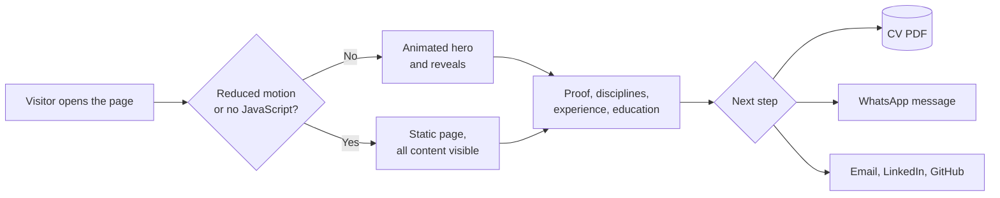
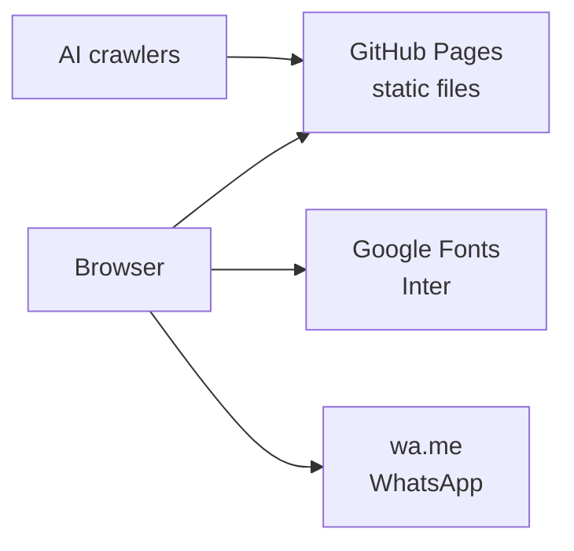

# dorianguzman.github.io

**A one-page profile of Dorian Guzman's work across AI engineering, strategy and go-to-market, for clients, partners and employers.**

https://github.com/dorianguzman/dorianguzman.github.io


People looking for help with AI usually meet two kinds of profiles: engineers who build but never own the commercial result, and strategists who advise but never ship. This site bets that one page can show both in a single person, with the proof in numbers and a clear way to start a conversation. Live at https://dorianguzman.github.io.

## How it works



Motion is an enhancement only: every word on the page is readable and every link is reachable with motion off, without JavaScript and with the keyboard alone.

## Architecture



## Technology

| Area | Technology | Use |
|---|---|---|
| Page | HTML5 | One semantic page with schema.org Person data |
| Styles | CSS3 | Layout and look; every value is a token in `:root` |
| Behaviour | Vanilla JavaScript | Contact form and scroll motion, no framework |
| Motion | GSAP 3.12.5 + ScrollTrigger | Scroll-driven reveals, vendored so nothing loads from a CDN |
| Type | Google Fonts (Inter) | The only typeface |
| Hosting | GitHub Pages | Publishes `main` on every push |
| AI discovery | `llms.txt` | Plain-text summary of the page for AI crawlers |

Invariants: no build step; content must be complete without JavaScript and with reduced motion; page copy, `llms.txt` and the CV must agree; no em dash in anything visible.

## Project structure

```text
dorianguzman.github.io/
├── index.html          the page
├── llms.txt            summary of the page for AI crawlers
├── css/
│   └── style.css       all styles, values as tokens in :root
├── js/
│   ├── main.js         contact form and scroll motion
│   └── vendor/         GSAP and ScrollTrigger, pinned version
└── assets/
    ├── cv/             downloadable CV (PDF)
    ├── images/         profile photo and share image
    └── favicon.svg     source for every favicon size
```

## Getting started

**Prerequisites:** Python 3 (or any static file server) and Git.

```sh
git clone https://github.com/dorianguzman/dorianguzman.github.io.git  # get the code
cd dorianguzman.github.io                                            # enter the project
python3 -m http.server 8000                                          # serve it at http://localhost:8000
git push origin main                                                 # publish: GitHub Pages deploys main
```

## Status

| Area | State |
|---|---|
| Page design and content | Live, 2026-11-09 |
| Motion, layout and accessibility checks in Chrome (desktop and phone emulation) | Done, 2026-11-09 |
| Testing on Safari and real phones | Not started |

Created by [Dorian Guzman](https://github.com/dorianguzman)
